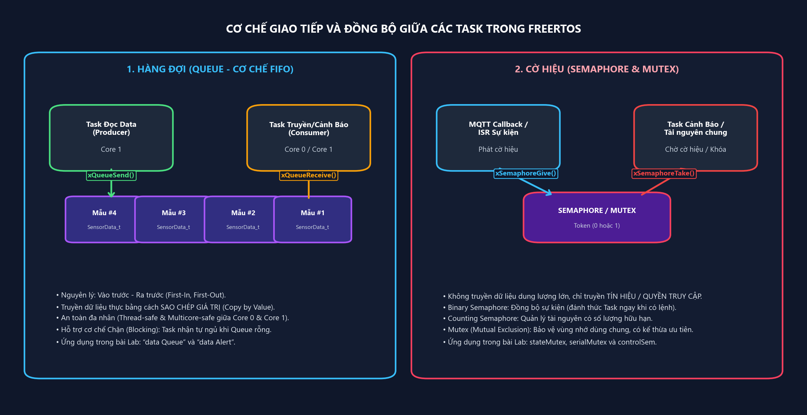
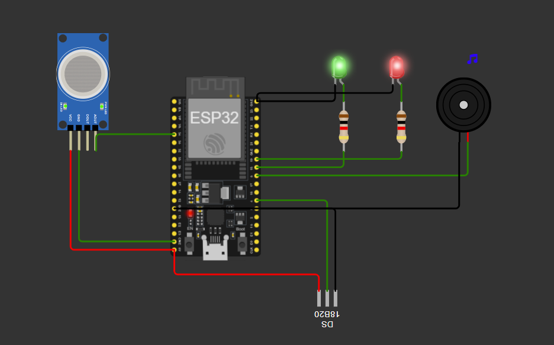
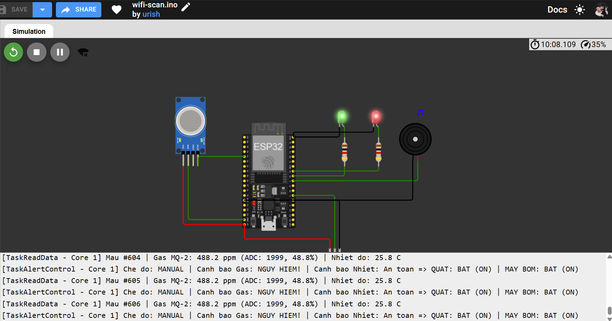
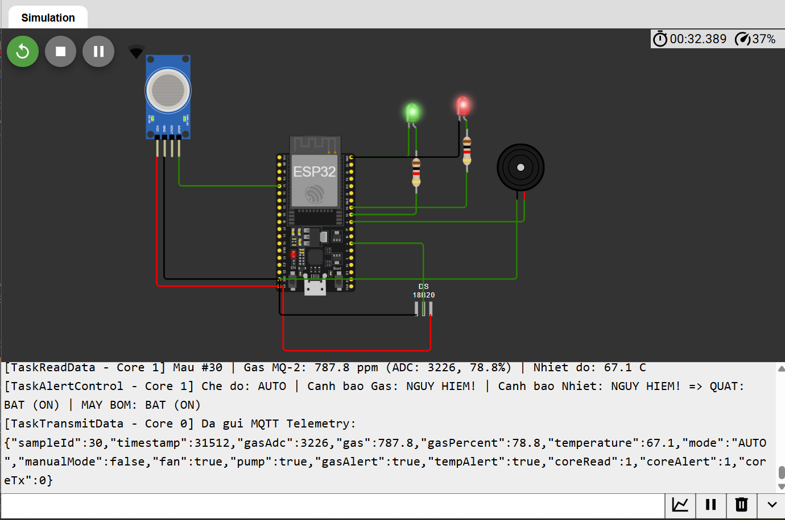
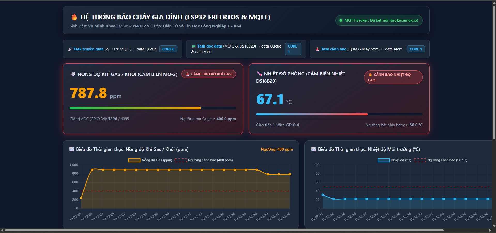
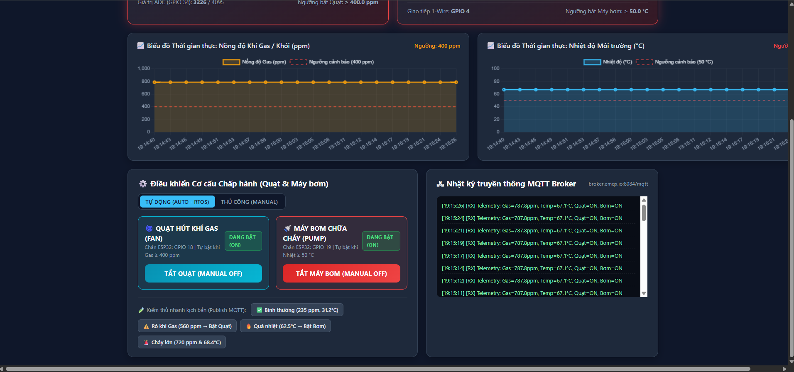

# Thiết kế Mạch báo cháy gia đình sử dụng ESP32, FreeRTOS và MQTT

- **Họ và tên:** Vũ Minh Khoa
- **Mã sinh viên:** 231432270
- **Lớp:** Điện Tử và Tin Học Công Nghiệp 1 - K64
- **Học phần:** Hệ thống Nhúng
- **Đề tài:** Thiết kế Mạch báo cháy gia đình sử dụng ESP32, FreeRTOS và MQTT
- **Link Project Wokwi:** [https://wokwi.com/projects/480213745557716993](https://wokwi.com/projects/480213745557716993)

---

## 1. ĐỀ BÀI VÀ YÊU CẦU THỰC HIỆN

Thiết kế Mạch báo cháy gia đình bằng việc phát hiện khí gas/khói và nhiệt độ. Mạch báo cháy sử dụng ESP32 đọc dữ liệu nồng độ khí gas/khói từ cảm biến MQ2 và nhiệt độ từ cảm biến nhiệt, hiển thị dữ liệu qua giao tiếp serial. Đồng thời ESP32 gửi dữ liệu lên MQTT Broker qua Wifi và hiển thị dữ liệu trên Web/App. Yêu cầu thực hiện:

- **Vẽ mạch kết nối trong Wokwi:** Kết nối vi điều khiển ESP32 với cảm biến khí gas/khói MQ-2, cảm biến nhiệt độ DS18B20 và cơ cấu chấp hành (Quạt, Máy bơm, Còi báo cháy).
- **Thiết kế giao diện trên Web/App:** Đọc dữ liệu từ MQTT Broker hiển thị trên thẻ HTML có thuộc tính `'class'` và nút `'button'` để điều khiển cơ cấu chấp hành, bao gồm:
  1. 2 thẻ HTML hiển thị dữ liệu nồng độ khí gas và nhiệt độ dạng số.
  2. 2 biểu đồ cập nhật dữ liệu nồng độ khí gas và nhiệt độ trực tiếp theo thời gian thực.
  3. 2 nút button để điều khiển trạng thái máy bơm và quạt ở chế độ Manual.
- **Xây dựng hệ RTOS cho hoạt động của ESP32:** Phân tách chương trình thành 3 Task chạy song song trên 2 nhân (Core 0 và Core 1) của ESP32:
  1. **Task truyền data:** chạy Core 0 kết nối Wi-Fi, đọc dữ liệu từ hàng đợi `'data Queue'` và gửi lên MQTT Broker.
  2. **Task đọc data:** chạy Core 1 đọc dữ liệu MQ-2 và cảm biến nhiệt, hiển thị qua Serial, gửi dữ liệu đầy đủ vào hàng đợi `'data Queue'` và hàng đợi `'data Alert'`.
  3. **Task cảnh báo:** chạy Core 1 đọc dữ liệu từ hàng đợi `'data Alert'` và điều khiển Quạt (bật khi khí gas vượt ngưỡng) và máy bơm (bật khi nhiệt độ vượt ngưỡng).

---

## 2. GIỚI THIỆU VỀ RTOS VÀ ƯU / NHƯỢC ĐIỂM CỦA FREERTOS

### 2.1. Tổng quan và các ưu điểm nổi bật của Hệ điều hành thời gian thực (RTOS)

Hệ điều hành thời gian thực là hệ điều hành chuyên dụng cho các hệ thống nhúng, được thiết kế để đảm bảo các tác vụ được thực thi trong một khoảng thời gian xác định trước. Khác với mô hình lập trình tuần tự truyền thống, RTOS sở hữu bộ lập lịch cho phép chia nhỏ bài toán phức tạp thành nhiều Task độc lập chạy song song.

1. **Tính tiền định và phản hồi thời gian thực:** Trong mạch báo cháy, tác vụ phát hiện vượt ngưỡng và kích hoạt Quạt/Máy bơm (`'Task cảnh báo'`) cần được phản hồi ngay lập tức. Với cơ chế lập lịch ưu tiên có trưng dụng, ngay khi có dữ liệu nguy hiểm trong hàng đợi `'data Alert'`, bộ lập lịch RTOS sẽ lập tức chuyển ngữ cảnh sang Task cảnh báo mà không bị chặn bởi quá trình chờ mạng Wi-Fi hay MQTT.
2. **Khai thác tối đa kiến trúc đa nhân trên ESP32:** Vi điều khiển ESP32 tích hợp 2 nhân xử lý Xtensa LX6 32-bit (Core 0 - Protocol CPU và Core 1 - Application CPU). RTOS cho phép ghim (pin) các tác vụ mạng tốn thời gian chờ I/O (`'Task truyền data'`) vào Core 0, trong khi ghim các tác vụ đo lường và điều khiển thời gian thực (`'Task đọc data'`, `'Task cảnh báo'`) vào Core 1.
3. **Tính mô-đun hóa cao và dễ bảo trì, mở rộng:** Mỗi Task đảm nhận một chức năng rõ ràng với vùng nhớ ngăn xếp riêng biệt. Khi cần nâng cấp giao thức truyền thông hoặc thêm cảm biến mới, lập trình viên chỉ cần chỉnh sửa Task tương ứng mà không làm xáo trộn thời gian thực thi của các Task còn lại.
4. **Sử dụng hiệu quả tài nguyên CPU và năng lượng:** Thay vì dùng vòng lặp bận gây lãng phí chu kỳ máy, các hàm API của RTOS như `vTaskDelayUntil()`, `xQueueReceive()` sẽ đưa Task đang chờ về trạng thái Blocked, nhường hoàn toàn CPU cho các Task khác.

### 2.2. Giới thiệu về FreeRTOS và phân tích ưu điểm và nhược điểm

FreeRTOS là hệ điều hành thời gian thực mã nguồn mở phổ biến nhất thế giới dành cho vi điều khiển. Trên ESP32, hãng Espressif đã tích hợp sẵn phiên bản ESP-IDF FreeRTOS hỗ trợ xử lý đa đối xứng trên cả hai nhân Core 0 và Core 1.

| Tiêu chí | Ưu điểm của FreeRTOS | Nhược điểm và thách thức của FreeRTOS |
| :--- | :--- | :--- |
| **Dung lượng và chi phí** | - Mã nguồn mở hoàn toàn miễn phí. - Nhân (Kernel) cực kỳ gọn nhẹ, chỉ chiếm khoảng 6 KB – 12 KB ROM và vài trăm byte RAM. | Không cung cấp sẵn các dịch vụ cấp cao phức tạp (như hệ thống quản lý file đầy đủ, giao diện đồ họa, bảo mật cấp OS) nếu không cài thêm thư viện ngoài. |
| **Hiệu năng và đa nhiệm** | Hỗ trợ lập lịch Preemptive, Time-slicing (chia sẻ lát cắt thời gian) và hỗ trợ chạy đa nhân SMP trên ESP32 với hàm `xTaskCreatePinnedToCore()`. | Chi phí chuyển ngữ cảnh và quản lý Tick Timer tiêu tốn một phần nhỏ chu kỳ CPU so với chương trình Bare-metal đơn giản. |
| **Cơ chế giao tiếp và đồng bộ** | Cung cấp đầy đủ các đối tượng IPC chuẩn: Queue, Binary/Counting Semaphore, Mutex, Event Groups, Task Notifications. | Đòi hỏi người lập trình phải nắm vững tư duy lập trình song song; nếu thiết kế sai dễ gặp các lỗi kinh điển như Deadlock, Race Condition hoặc Priority Inversion. |
| **Quản lý bộ nhớ** | Cung cấp 5 mô hình cấp phát Heap linh hoạt (`heap_1` đến `heap_5`) và tích hợp trực tiếp vào bộ nhớ SRAM của ESP32. | Mỗi Task cần cấp phát sẵn một vùng Stack cố định. Nếu tính toán quá nhỏ sẽ gây lỗi Stack Overflow làm treo chip; nếu cấp quá lớn sẽ gây lãng phí RAM. |

---

## 3. CƠ CHẾ GIAO TIẾP GIỮA CÁC TASK: CỜ HIỆU VÀ HÀNG ĐỢI

Trong hệ thống đa nhiệm FreeRTOS, các Task hoạt động độc lập nhưng cần trao đổi dữ liệu và đồng bộ hóa thứ tự thực thi. Việc sử dụng biến toàn cục thông thường giữa các Task chạy trên hai nhân khác nhau (Core 0 và Core 1) rất dễ dẫn đến hiện tượng xung đột dữ liệu khi một Task đang ghi dở thì Task khác nhảy vào đọc. Do đó, FreeRTOS cung cấp hai cơ chế cốt lõi là Cờ hiệu và Hàng đợi.

### 3.1. Cơ chế cờ hiệu
Cờ hiệu là một cơ chế báo hiệu và đồng bộ hóa giữa các Task hoặc giữa ngắt (ISR) với Task, hoạt động dựa trên một biến đếm nguyên mà không dùng để truyền tải gói dữ liệu lớn. Hai thao tác cơ bản trên Semaphore là: `xSemaphoreTake` và `xSemaphoreGive`.
- **Cờ hiệu nhị phân:** Chỉ có hai giá trị 0 (trống) và 1 (có sẵn). Thường dùng để đồng bộ hóa sự kiện: Task xử lý gọi `xSemaphoreTake()` và ngủ chờ; khi có sự kiện, hàm Callback gọi `xSemaphoreGive(controlSem)` để đánh thức Task cảnh báo dậy xử lý tức thời.
- **Cờ hiệu đếm:** Có giá trị đếm từ 0 đến N, dùng để đếm số lượng sự kiện phát sinh hoặc quản lý một nhóm tài nguyên có số lượng giới hạn.
- **Mutual Exclusion (Mutex):** Là loại Semaphore đặc biệt dùng để bảo vệ tài nguyên dùng chung. Task nào muốn truy cập tài nguyên phải `'khóa'` Mutex (Take) và `'mở khóa'` (Give) ngay sau khi xong. Đặc biệt, Mutex trong FreeRTOS có cơ chế Kế thừa mức ưu tiên giúp ngăn chặn triệt để lỗi Đảo ngược độ ưu tiên.

### 3.2. Cơ chế hàng đợi
Hàng đợi là cơ chế chính để truyền dữ liệu thực sự giữa các Task trong FreeRTOS. Queue hoạt động theo cấu trúc FIFO với kích thước phần tử và độ dài hàng đợi được xác định khi khởi tạo bằng hàm `xQueueCreate(uxQueueLength, uxItemSize)`.
- **Truyền dữ liệu theo giá trị:** Khi Task gọi `xQueueSend()`, FreeRTOS sao chép toàn bộ nội dung biến cấu trúc vào bộ nhớ đệm nội bộ của Queue. Nhờ đó, Task gửi có thể tái sử dụng hoặc hủy biến cục bộ ngay lập tức mà không sợ làm hỏng dữ liệu của Task nhận.
- **An toàn tuyệt đối giữa nhiều Task và nhiều Core:** FreeRTOS tự động sử dụng các khóa spinlock phần cứng bên trong Queue, cho phép `'Task đọc data'` ở Core 1 gửi dữ liệu sang `'Task truyền data'` ở Core 0 qua `'data Queue'` một cách an toàn tuyệt đối.
- **Cơ chế Chặn thông minh:** Khi `'Task cảnh báo'` gọi `xQueueReceive(dataAlertQueue, &alertData, portMAX_DELAY)`, nếu hàng đợi đang rỗng, Task sẽ tự động chuyển sang trạng thái Blocked (không tốn 0% CPU nào) và lập tức thức dậy ngay ở micro-giây mà `'Task đọc data'` đẩy mẫu cảm biến mới vào hàng đợi.

*Hình 1. Sơ đồ nguyên lý hoạt động và ứng dụng của hàng đợi và cờ hiệu*

| Đặc điểm so sánh | Hàng đợi | Cờ hiệu |
| :--- | :--- | :--- |
| **Mục đích chính** | Truyền tải dữ liệu giữa các Task. | Đồng bộ hóa sự kiện hoặc bảo vệ tài nguyên dùng chung. |
| **Dữ liệu mang theo** | Sao chép toàn bộ gói dữ liệu. | Không chứa dữ liệu, chỉ lưu trạng thái/biến đếm Token. |
| **Hàm API trong FreeRTOS** | `xQueueCreate()`, `xQueueSend()`, `xQueueReceive()` | `xSemaphoreCreateBinary()`, `xSemaphoreCreateMutex()`, `xSemaphoreTake()`, `xSemaphoreGive()` |
| **Ứng dụng thực tế trong bài Lab** | 1. `'data Queue'`: Truyền `SensorData_t` từ Task đọc data (Core 1) sang Task truyền data (Core 0). 2. `'data Alert'`: Truyền `SensorData_t` từ Task đọc data (Core 1) sang Task cảnh báo (Core 1). | 1. `'stateMutex'`: Bảo vệ cấu trúc trạng thái Quạt/Bơm/Chế độ (`sysState`). 2. `'serialMutex'`: Tránh xung đột khi Core 0 và Core 1 cùng in Serial. 3. `'controlSem'`: Đánh thức Task cảnh báo khi bấm nút Manual trên Web. |

---

## 4. TRÌNH BÀY CÁC BƯỚC THỰC HIỆN BÀI LAB

### 4.1. Sơ đồ mạch trong Wokwi và Bảng kết nối chân phần cứng

Mạch mô phỏng trên Wokwi sử dụng vi điều khiển trung tâm ESP32-DevKitC kết nối với:
- Cảm biến khí gas/khói MQ-2
- Cảm biến nhiệt độ số DS18B20
- Quạt hút khói/gas (mô phỏng bằng LED Xanh công suất)
- Máy bơm nước chữa cháy (mô phỏng bằng LED Đỏ công suất)
- Còi báo cháy Buzzer

- **Link Project Wokwi:** [https://wokwi.com/projects/480213745557716993](https://wokwi.com/projects/480213745557716993)

| Cảm biến | Thông số kỹ thuật | Đơn vị đo | Chân kết nối | Chức năng trong hệ thống |
| :--- | :--- | :---: | :--- | :--- |
| **Cảm biến khí Gas/Khói MQ-2** | Đọc giá trị tương tự qua bộ ADC 12-bit của ESP32 (0 – 4095), quy đổi dải nồng độ 0 – 1000 ppm (ngưỡng cảnh báo ≥ 400 ppm). | ppm (và %) | `VCC` → `5V` `GND` → `GND` `AOUT` → `GPIO 34` `DOUT` → `GPIO 35` | Phát hiện rò rỉ khí gas và khói đám cháy. |
| **Cảm biến nhiệt độ DS18B20** | Cảm biến nhiệt độ số chuẩn giao tiếp 1-Wire, dải đo từ -55 °C đến +125 °C, sai số ±0.5 °C (ngưỡng cảnh báo ≥ 50 °C). | °C (Độ C) | `VCC` → `3V3` `GND` → `GND` `DQ` → `GPIO 4` | Đo nhiệt độ môi trường phòng theo thời gian thực để phát hiện đám cháy. |
| **Quạt** | Ngõ ra số Digital Output (mức HIGH = 3.3V kích dẫn Relay / sáng LED Xanh qua trở 220 Ω). | Trạng thái BẬT (1) / TẮT (0) | `GPIO 18` → Anode LED Xanh (Relay Quạt) | Tự động BẬT khi nồng độ khí gas vượt ngưỡng (≥ 400 ppm) hoặc điều khiển bằng nút nhấn Web. |
| **Máy bơm** | Ngõ ra số Digital Output (mức HIGH = 3.3V kích dẫn Relay / sáng LED Đỏ qua trở 220 Ω). | Trạng thái BẬT (1) / TẮT (0) | `GPIO 19` → Anode LED Đỏ (Relay Bơm) | Tự động BẬT khi nhiệt độ vượt ngưỡng (≥ 50 °C) hoặc điều khiển bằng nút nhấn Web. |
| **Còi báo động (Buzzer)** | Ngõ ra xung PWM âm thanh tần số 2000 Hz khi có cảnh báo. | Hz / ON-OFF | `GPIO 5` → Buzzer (+) | Phát âm thanh cảnh báo tại chỗ khi phát hiện khí gas hoặc nhiệt độ vượt ngưỡng. |

*Hình 2. Sơ đồ mạch kết nối ESP32, cảm biến MQ-2, DS18B20 và cơ cấu chấp hành quạt, máy bơm*

---

### 4.2. Triển khai FreeRTOS trên ESP32 và Bảng dữ liệu cho các Task

Hệ thống phần mềm trên ESP32 được thiết kế theo đúng kiến trúc RTOS yêu cầu của đề bài, phân bổ tường minh trên 2 nhân vật lý của ESP32 thông qua hàm `xTaskCreatePinnedToCore()`:

*Hình 3. Sơ đồ kiến trúc đa nhiệm FreeRTOS trên 2 nhân (Core 0 & Core 1) và luồng dữ liệu qua 2 hàng đợi 'data Queue' và 'data Alert'.*

**Bảng 1 dưới đây trình bày chi tiết thông số thiết kế của 3 Task trong hệ thống FreeRTOS:**

| Tên Task theo đề bài | Tên hàm trong Code | Core thực thi | Độ ưu tiên | Kích thước Stack | Hàng đợi giao tiếp |
| :--- | :--- | :---: | :---: | :---: | :--- |
| **Task truyền data** | `TaskTransmitData` | Core 0 (Protocol CPU) | 2 | 8192 bytes | • Kết nối Wi-Fi (`Wokwi-GUEST`) và kết nối MQTT Broker (`broker.emqx.io`). • Nếu kết nối thành công, đọc dữ liệu từ hàng đợi `'data Queue'` (`xQueueReceive`) và đóng gói JSON gửi lên topic `telemetry`. • Nhận lệnh điều khiển từ 2 nút button trên Web qua topic `control`. |
| **Task đọc data** | `TaskReadData` | Core 1 (App CPU) | 2 | 4096 bytes | • Chu kỳ 1000 ms (sử dụng `vTaskDelayUntil`). • Đọc nồng độ khí gas từ cảm biến MQ-2 (`GPIO 34`) và nhiệt độ từ DS18B20 (`GPIO 4`). • Hiển thị đầy đủ thông số qua giao tiếp Serial Monitor. • Gửi bản ghi `SensorData_t` vào cả 2 hàng đợi: `'data Queue'` và `'data Alert'`. |
| **Task cảnh báo** | `TaskAlertControl` | Core 1 (App CPU) | 3 (Cao nhất) | 4096 bytes | • Đọc dữ liệu từ hàng đợi `'data Alert'` (Blocking Read). • Kiểm tra ngưỡng báo cháy và điều khiển cơ cấu chấp hành:   + Quạt (`GPIO 18`) BẬT khi nồng độ khí gas ≥ 400 ppm.   + Máy bơm (`GPIO 19`) BẬT khi nhiệt độ ≥ 50 °C.   + Khi ở chế độ Manual: thực thi lệnh bật/tắt trực tiếp từ nút nhấn Web. |

**Bảng 2 mô tả cấu trúc gói dữ liệu `SensorData_t` được truyền bên trong hai hàng đợi `'data Queue'` và `'data Alert'`:**

| Tên trường dữ liệu | Kiểu dữ liệu C/C++ | Kích thước | Ý nghĩa và phạm vi giá trị |
| :--- | :---: | :---: | :--- |
| `sampleId` | `uint32_t` | 4 bytes | Số thứ tự mẫu đo tăng dần từ khi ESP32 khởi động. |
| `timestampMs` | `uint32_t` | 4 bytes | Thời điểm lấy mẫu tính bằng mili-giây (`millis()`). |
| `gasAdc` | `int` | 4 bytes | Giá trị số nguyên ADC 12-bit đọc từ chân AOUT của MQ-2 (0 – 4095). |
| `gasPpm` | `float` | 4 bytes | Nồng độ khí gas/khói quy đổi theo thang đo (0.0 – 1000.0 ppm). |
| `gasPercent` | `float` | 4 bytes | Tỉ lệ phần trăm nồng độ khí gas (0.0 – 100.0 %). |
| `temperatureC` | `float` | 4 bytes | Nhiệt độ đọc từ cảm biến nhiệt DS18B20 (-55.0 đến +125.0 °C). |
| `gasExceed` | `bool` | 1 byte | Cờ cảnh báo khí gas vượt ngưỡng (`true` khi `gasPpm ≥ 400.0 ppm`). |
| `tempExceed` | `bool` | 1 byte | Cờ cảnh báo nhiệt độ vượt ngưỡng (`true` khi `temperatureC ≥ 50.0 °C`). |

**Bảng 3 tổng hợp thuật toán điều khiển cơ cấu chấp hành Quạt và Máy bơm:**

| Cơ cấu chấp hành | Chân GPIO | Điều kiện BẬT (Chế độ Auto) | Điều kiện TẮT (Chế độ Auto) | Hoạt động ở chế độ Manual |
| :--- | :---: | :--- | :--- | :--- |
| **Quạt hút khói/gas** | `GPIO 18` | Nồng độ khí gas ≥ 400.0 ppm | Nồng độ khí gas ≤ 360.0 ppm | Bật / Tắt trực tiếp khi nhấn nút `<button>` Quạt trên Web. |
| **Máy bơm chữa cháy** | `GPIO 19` | Nhiệt độ ≥ 50.0 °C | Nhiệt độ ≤ 47.0 °C | Bật / Tắt trực tiếp khi nhấn nút `<button>` Máy bơm trên Web. |

---

### 4.3. Thiết kế giao diện trên Website/App để hiển thị dữ liệu và điều khiển

Giao diện giám sát và điều khiển (tệp `web_dashboard/index.html`) được xây dựng bằng HTML5, CSS3, thư viện MQTT.js (kết nối tới MQTT Broker `broker.emqx.io` qua WebSockets tại cổng `8084`) và thư viện Chart.js.

1. **Hai thẻ HTML có thuộc tính `'class'` hiển thị số liệu nồng độ khí gas và nhiệt độ:** Sử dụng thẻ `
` chứa `` để hiển thị nồng độ khí gas (ppm) và thẻ `
` chứa `` để hiển thị nhiệt độ (°C). Trong JavaScript, chương trình truy xuất trực tiếp qua `document.querySelector('.gas-value')` và `document.querySelector('.temp-value')` để cập nhật giá trị ngay khi nhận bản tin từ MQTT Broker.
2. **Hai biểu đồ cập nhật trực tiếp theo thời gian thực:** Sử dụng hai thẻ `<canvas id='gasRealtimeChart' class='realtime-chart'>` và `<canvas id='tempRealtimeChart' class='realtime-chart'>` vẽ đường biến thiên nồng độ khí gas (ppm) và nhiệt độ (°C) theo từng thời điểm nhận gói tin, có kèm đường nét đứt màu đỏ biểu diễn ngưỡng cảnh báo (`400 ppm` và `50 °C`).
3. **Hai nút `<button>` điều khiển trạng thái Máy bơm và Quạt (chế độ Manual):** Sử dụng thẻ `<button class='control-button btn-fan-control' onclick='toggleFanManual()'>` và `<button class='control-button btn-pump-control' onclick='togglePumpManual()'>`. Khi người dùng nhấn nút, giao diện Web sẽ xuất bản (Publish) bản tin JSON `{'cmd':'setFan','state':true/false}` hoặc `{'cmd':'setPump','state':true/false}` lên topic `fire_alarm_vmk_231432270/control` để ESP32 chuyển sang chế độ Manual và bật/tắt ngay cơ cấu chấp hành tương ứng.

---

## 5. KẾT QUẢ ĐẠT ĐƯỢC BẰNG HÌNH ẢNH

### 5.1. Kết quả mô phỏng mạch và hoạt động của hệ FreeRTOS trên Wokwi
Khi khởi chạy mô phỏng trên Wokwi, ESP32 khởi tạo thành công 2 hàng đợi (`'data Queue'`, `'data Alert'`) và 3 Task trên Core 0 và Core 1. Ở trạng thái bình thường (Nồng độ khí gas = 245 ppm < 400 ppm, Nhiệt độ = 31.5 °C < 50 °C), cả Quạt (`GPIO 18`) và Máy bơm (`GPIO 19`) đều ở trạng thái TẮT (OFF). Khi kéo thanh trượt tăng nồng độ khí gas trên cảm biến MQ-2 vượt quá 400 ppm (ví dụ 787.8 ppm) và tăng nhiệt độ trên cảm biến DS18B20 vượt quá 50 °C (ví dụ 67.1 °C), `'Task đọc data'` lập tức đẩy dữ liệu vào `'data Alert'` để `'Task cảnh báo'` bật sáng đèn LED Quạt (`GPIO 18`), bật sáng đèn LED Máy bơm (`GPIO 19`) và kích hoạt Còi báo cháy (`GPIO 5`).

*Hình 4. Kết quả mô phỏng trên Wokwi khi nồng độ khí gas và nhiệt độ vượt ngưỡng*

### 5.2. Kết quả hiển thị dữ liệu và điều khiển trên giao diện Web/App
Trên giao diện Web/App, dữ liệu nhận trực tiếp từ MQTT Broker được hiển thị tức thời lên 2 thẻ HTML sử dụng thuộc tính `'class'` (`.gas-value` và `.temp-value`) và cập nhật liên tục lên 2 biểu đồ thời gian thực. Người dùng có thể nhấn trực tiếp vào 2 nút `<button>` `'BẬT/TẮT QUẠT'` và `'BẬT/TẮT MÁY BƠM'` để chuyển sang chế độ Manual và điều khiển đóng/ngắt cơ cấu chấp hành từ xa.

*Hình 5. Giao diện Web/App hiển thị*

*Hình 6. Giao diện Web/App khi phát hiện cảnh báo vượt ngưỡng và điều khiển bật/tắt Máy bơm, Quạt*
