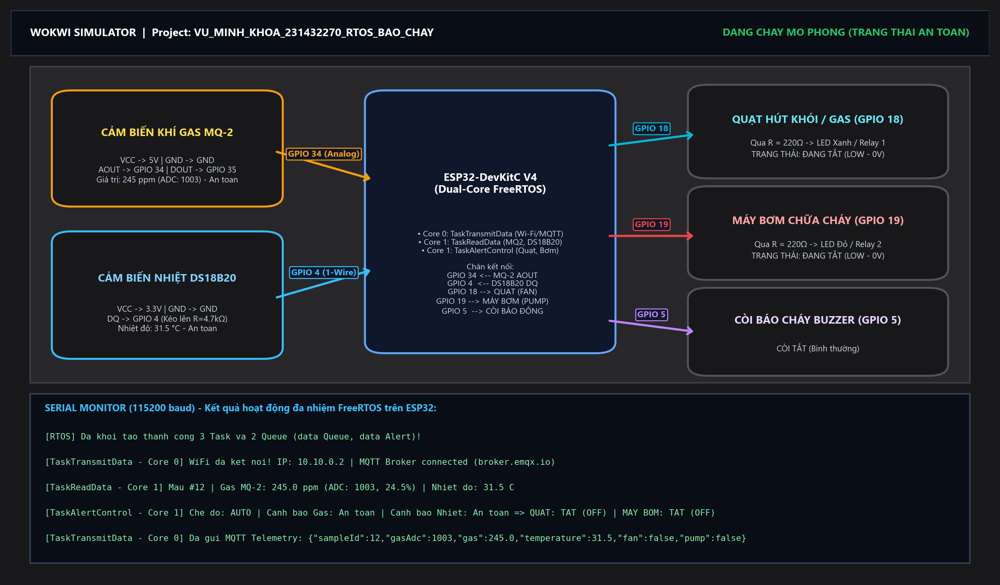
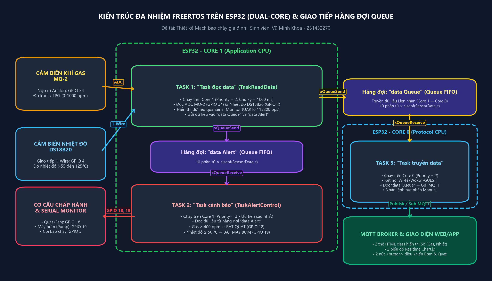
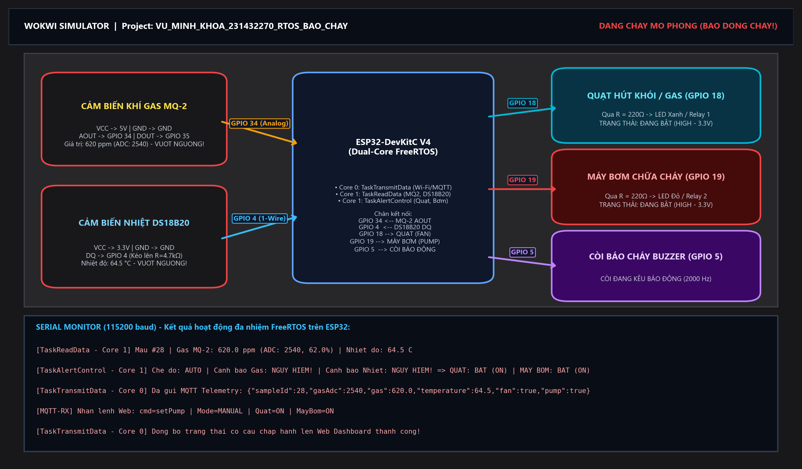
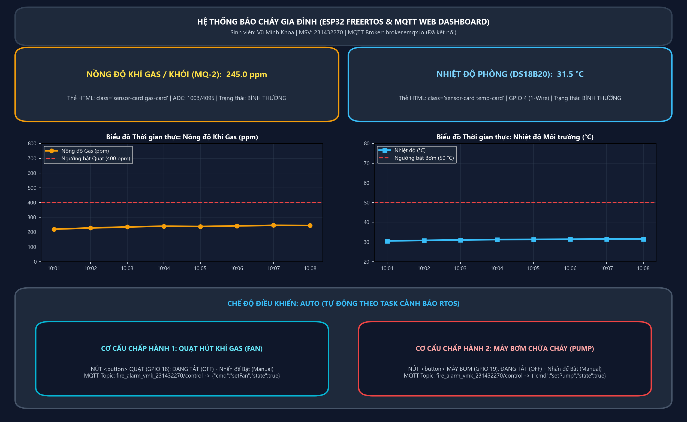
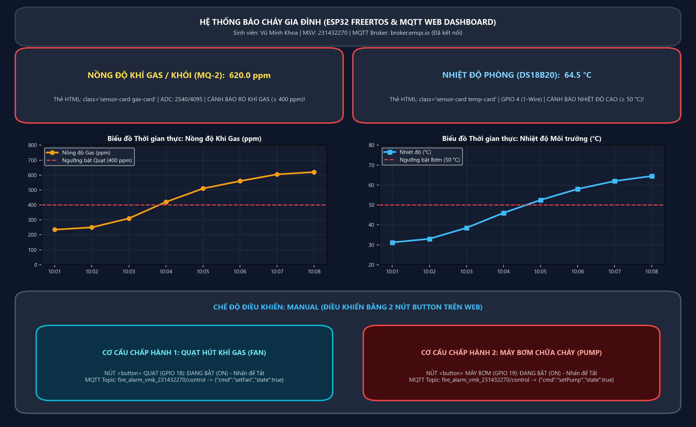

# BÁO CÁO BÀI LAB HỆ THỐNG NHÚNG
## Đề tài: Thiết kế Mạch báo cháy gia đình sử dụng ESP32, Hệ điều hành thời gian thực FreeRTOS, MQTT Broker và Giao diện Web/App

- **Sinh viên thực hiện:** Vũ Minh Khoa
- **Mã sinh viên:** 231432270
- **Lớp:** Điện Tử và Tin Học Công Nghiệp 1 - K64

---

## 1. Đề bài và Yêu cầu kỹ thuật

Thiết kế **Mạch báo cháy gia đình** bằng việc phát hiện khí gas/khói và nhiệt độ. Mạch báo cháy sử dụng **ESP32** đọc dữ liệu nồng độ khí gas/khói từ cảm biến **MQ-2** và nhiệt độ từ **cảm biến nhiệt (DS18B20)**, hiển thị dữ liệu qua giao tiếp **Serial**. Đồng thời ESP32 gửi dữ liệu lên **MQTT Broker** qua Wi-Fi và hiển thị dữ liệu trên **Web/App**.

### Các yêu cầu thực hiện chi tiết:
1. **Vẽ mạch kết nối trong Wokwi:** Kết nối ESP32 với cảm biến khí gas/khói MQ-2, cảm biến nhiệt độ DS18B20 và các cơ cấu chấp hành (Quạt, Máy bơm, Còi báo cháy).
2. **Thiết kế giao diện trên Web/App:** Hiển thị dữ liệu đọc được từ MQTT Broker trên thẻ HTML có thuộc tính `class` và nút `<button>` để điều khiển cơ cấu chấp hành:
   - **2 thẻ HTML (`class`)** hiển thị dữ liệu **Nồng độ khí gas** và **Nhiệt độ** dạng số.
   - **2 biểu đồ (Charts)** cập nhật dữ liệu **Nồng độ khí gas** và **Nhiệt độ** trực tiếp theo thời gian thực.
   - **2 nút `<button>`** để điều khiển trạng thái **Máy bơm** và **Quạt** (chế độ `Manual`).
3. **Xây dựng hệ RTOS cho hoạt động của ESP32:**
   - **“Task truyền data” (`TaskTransmitData`)**: chạy **Core 0**, kết nối Wi-Fi, nếu thành công đọc dữ liệu từ hàng đợi **`data Queue`** và gửi lên **MQTT Broker**.
   - **“Task đọc data” (`TaskReadData`)**: chạy **Core 1**, đọc dữ liệu cảm biến MQ-2 và nhiệt độ từ cảm biến nhiệt, hiển thị dữ liệu qua giao tiếp **Serial**, gửi dữ liệu đầy đủ vào hàng đợi **`data Queue`** và vào hàng đợi **`data Alert`**.
   - **“Task cảnh báo” (`TaskAlertControl`)**: chạy **Core 1**, đọc dữ liệu từ hàng đợi **`data Alert`** và thực hiện điều khiển cơ cấu chấp hành là **Quạt** và **Máy bơm** (**Quạt bật** khi nồng độ khí gas vượt ngưỡng, **Máy bơm bật** khi nhiệt độ vượt ngưỡng).

---

## 2. Giới thiệu về ưu điểm của RTOS và Ưu / Nhược điểm của FreeRTOS

### 2.1. Hệ điều hành thời gian thực (RTOS) và các ưu điểm nổi bật
**RTOS (Real-Time Operating System)** là hệ điều hành chuyên dụng cho các hệ thống nhúng, quản lý tài nguyên phần cứng và lập lịch thực thi các tác vụ (**Tasks**) sao cho mọi sự kiện quan trọng đều được xử lý trong một giới hạn thời gian xác định trước (**Deterministic Timing**).

So với phương pháp lập trình tuần tự truyền thống (**Super-Loop** dùng `while(1)` hoặc `loop()` kèm `delay()`), RTOS mang lại các ưu điểm vượt trội:
1. **Đảm bảo tính thời gian thực và phản ứng tức thời (Determinism & Preemption):** Trong hệ thống báo cháy, việc kiểm tra ngưỡng nguy hiểm và kích hoạt Quạt/Máy bơm phải có độ ưu tiên cao nhất. Nhờ cơ chế lập lịch ưu tiên có trưng dụng (**Preemptive Priority Scheduling**), ngay khi `Task đọc data` đẩy mẫu vượt ngưỡng vào `data Alert`, bộ lập lịch sẽ lập tức chuyển ngữ cảnh sang `Task cảnh báo` để bật Quạt/Máy bơm mà không bị trễ bởi quá trình truyền mạng Wi-Fi/MQTT.
2. **Tận dụng tối đa kiến trúc Đa nhân (Dual-Core SMP) của ESP32:** ESP32 có 2 nhân vật lý là **Core 0 (Protocol CPU)** và **Core 1 (Application CPU)**. RTOS cho phép ghim (`xTaskCreatePinnedToCore`) tác vụ kết nối mạng Wi-Fi/MQTT vào **Core 0**, tách biệt hoàn toàn với 2 tác vụ đọc cảm biến và cảnh báo chạy trên **Core 1**.
3. **Tính mô-đun hóa và khả năng mở rộng cao (Modularity & Scalability):** Chương trình được chia thành các Task độc lập, mỗi Task có vùng ngăn xếp (**Stack**) và vòng đời riêng, giúp dễ dàng bảo trì, gỡ lỗi và bổ sung tính năng mới.
4. **Tối ưu hóa hiệu suất CPU:** Khi một Task chờ dữ liệu từ hàng đợi (`xQueueReceive`) hoặc chờ đến chu kỳ lấy mẫu tiếp theo (`vTaskDelayUntil`), Task đó chuyển sang trạng thái **Blocked**, giải phóng 100% chu kỳ CPU cho các Task khác hoạt động.

### 2.2. Ưu điểm và Nhược điểm của FreeRTOS

| Tiêu chí | Ưu điểm của FreeRTOS | Nhược điểm / Thách thức của FreeRTOS |
| :--- | :--- | :--- |
| **Dung lượng & Bản quyền** | Mã nguồn mở hoàn toàn miễn phí (MIT License). Nhân (Kernel) cực kỳ nhỏ gọn (chỉ tốn ~6–12 KB Flash và vài trăm byte RAM). | Chỉ cung cấp các dịch vụ cốt lõi (lập lịch, IPC, quản lý bộ nhớ); không tích hợp sẵn hệ thống file nâng cao hay giao diện đồ họa. |
| **Khả năng Đa nhiệm & Đa nhân** | Hỗ trợ lập lịch Preemptive, Cooperative, Time-Slicing và hỗ trợ đa nhân đối xứng (**SMP**) trên ESP32 (`Core 0` & `Core 1`). | Phát sinh chi phí chuyển ngữ cảnh (**Context Switch Overhead**) và ngắt hệ thống (`SysTick`) định kỳ (thường là 1 ms/tick). |
| **Cơ chế giao tiếp liên tác vụ (IPC)** | Cung cấp bộ công cụ IPC phong phú, an toàn: **Queue**, **Binary/Counting Semaphore**, **Mutex** (có *Priority Inheritance*), **Event Group**. | Nếu thiết kế không cẩn thận dễ dẫn đến các lỗi lập trình song song như **Deadlock** (khóa chết), **Race Condition** hoặc **Starvation**. |
| **Quản lý bộ nhớ** | Linh hoạt cấp phát động trên Heap của ESP32. | Phải ước lượng kích thước Stack cho từng Task (`usStackDepth`); cấp thiếu sẽ gây lỗi tràn ngăn xếp (**Stack Overflow**), cấp thừa gây lãng phí RAM. |

---

## 3. Cơ chế giao tiếp giữa các Task: Cờ hiệu (Semaphore) và Hàng đợi (Queue)

### 3.1. Cờ hiệu (Semaphore & Mutex)
**Semaphore (Cờ hiệu)** là cơ chế dùng để **đồng bộ hóa sự kiện** giữa các Task (hoặc giữa Ngắt ISR và Task) và **bảo vệ tài nguyên dùng chung** thông qua hai thao tác nguyên tử: **Take (`xSemaphoreTake`)** và **Give (`xSemaphoreGive`)**.
- **Binary Semaphore (Cờ hiệu nhị phân):** Chỉ có giá trị `0` hoặc `1`. Dùng để đánh thức một Task khi có sự kiện ngoại vi xảy ra. Trong bài Lab, `controlSem` được hàm `mqttCallback()` phát (`Give`) ngay khi nhận lệnh điều khiển từ nút nhấn Web để đánh thức `Task cảnh báo` cập nhật ngõ ra tức thì.
- **Counting Semaphore (Cờ hiệu đếm):** Giá trị nguyên từ `0` đến `N`, dùng để đếm số sự kiện hoặc quản lý nhóm tài nguyên hữu hạn.
- **Mutex (Mutual Exclusion):** Là Semaphore chuyên biệt dùng để khóa bảo vệ tài nguyên dùng chung (như `serialMutex` bảo vệ cổng `Serial` và `stateMutex` bảo vệ biến trạng thái `sysState` giữa Core 0 và Core 1). Mutex hỗ trợ **Kế thừa độ ưu tiên (Priority Inheritance)** giúp chống hiện tượng đảo ngược độ ưu tiên.

### 3.2. Hàng đợi (Queue)
**Queue (Hàng đợi)** là cơ chế chuẩn trong FreeRTOS dùng để **truyền tải dữ liệu có cấu trúc** giữa các Task theo nguyên tắc **FIFO (First-In, First-Out: Vào trước - Ra trước)**.
- **Sao chép theo giá trị (Copy by Value):** Khi gọi `xQueueSend()`, FreeRTOS sao chép toàn bộ nội dung cấu trúc dữ liệu (`SensorData_t`) vào vùng nhớ riêng của Queue, đảm bảo dữ liệu không bị ghi đè khi Task gửi tiếp tục vòng lặp mới.
- **An toàn đa nhân (Multicore Thread-Safe):** Queue sử dụng khóa phần cứng nội bộ của ESP32, cho phép `Task đọc data` trên **Core 1** truyền dữ liệu sang `Task truyền data` trên **Core 0** qua `data Queue` mà không xảy ra xung đột bộ nhớ.
- **Cơ chế chặn (Blocking Read/Write):** Task nhận gọi `xQueueReceive()` sẽ tự động ngủ (Blocked) khi hàng đợi trống và lập tức thức dậy ngay khi có gói dữ liệu mới được gửi vào.

### 3.3. Bảng so sánh giữa Hàng đợi (Queue) và Cờ hiệu (Semaphore)

| Tiêu chí | Hàng đợi (Queue) | Cờ hiệu (Semaphore / Mutex) |
| :--- | :--- | :--- |
| **Chức năng chính** | Truyền các gói dữ liệu (struct, số thực, mảng) giữa các Task. | Đồng bộ hóa thời điểm thực thi hoặc khóa bảo vệ tài nguyên dùng chung. |
| **Dung lượng dữ liệu** | Lưu trữ `N` phần tử, mỗi phần tử có kích thước `sizeof(Struct)` xác định. | Không lưu dữ liệu tải (Payload), chỉ lưu trạng thái cờ (`0/1` hoặc bộ đếm). |
| **Hàm API sử dụng** | `xQueueCreate()`, `xQueueSend()`, `xQueueReceive()` | `xSemaphoreCreateBinary()`, `xSemaphoreCreateMutex()`, `xSemaphoreTake()`, `xSemaphoreGive()` |
| **Ứng dụng trong bài Lab** | - **`data Queue`**: Truyền `SensorData_t` từ `Task đọc data` (Core 1) sang `Task truyền data` (Core 0). - **`data Alert`**: Truyền `SensorData_t` từ `Task đọc data` (Core 1) sang `Task cảnh báo` (Core 1). | - **`stateMutex`**: Bảo vệ biến trạng thái Quạt/Bơm/Mode (`sysState`). - **`serialMutex`**: Đồng bộ in `Serial` giữa Core 0 và Core 1. - **`controlSem`**: Báo hiệu khi có lệnh điều khiển Manual từ Web. |

---

## 4. Các bước thực hiện bài Lab

### 4.1. Sơ đồ mạch trong Wokwi và Bảng kết nối chân của ESP32

| Thiết bị / Linh kiện | Giới hạn đo & Thông số | Đơn vị | Chân Linh kiện | Chân ESP32 | Chức năng hoạt động |
| :--- | :--- | :---: | :--- | :---: | :--- |
| **Cảm biến khí Gas/Khói MQ-2** | ADC 12-bit (`0 – 4095`), quy đổi `0 – 1000 ppm` | `ppm` (`%`) | `VCC` / `GND` `AOUT` `DOUT` | `5V` / `GND` `GPIO 34` `GPIO 35` | Đọc nồng độ khí gas/khói tương tự qua bộ ADC1 của ESP32. |
| **Cảm biến nhiệt độ DS18B20** | Dải đo `-55 °C` đến `+125 °C` (giao tiếp 1-Wire) | `°C` | `VCC` / `GND` `DQ` (kèm trở kéo lên `4.7 kΩ`) | `3V3` / `GND` `GPIO 4` | Đo nhiệt độ môi trường chính xác qua chuẩn 1-Wire. |
| **Quạt hút khói/gas (Fan)** | Ngõ ra Digital (`LOW = 0V`, `HIGH = 3.3V`) | `ON / OFF` | Anode LED Xanh / Relay 1 (qua trở `220 Ω`) | `GPIO 18` | **BẬT** khi nồng độ khí gas vượt ngưỡng (`≥ 400 ppm`) hoặc bật từ nút nhấn Web. |
| **Máy bơm chữa cháy (Pump)** | Ngõ ra Digital (`LOW = 0V`, `HIGH = 3.3V`) | `ON / OFF` | Anode LED Đỏ / Relay 2 (qua trở `220 Ω`) | `GPIO 19` | **BẬT** khi nhiệt độ vượt ngưỡng (`≥ 50 °C`) hoặc bật từ nút nhấn Web. |
| **Còi báo cháy (Buzzer)** | Phát xung âm thanh `2000 Hz` khi nguy hiểm | `Hz` | Chân tín hiệu `+` / `-` | `GPIO 5` / `GND` | Phát âm thanh cảnh báo tại chỗ khi vượt ngưỡng cháy nổ. |

---

### 4.2. Triển khai FreeRTOS trên ESP32 và Bảng dữ liệu cho các Task

#### a) Bảng phân bổ và thông số hoạt động của các Task trên ESP32

| Tên Task theo yêu cầu | Tên hàm trong Code | Nhân thực thi (Core) | Mức ưu tiên (Priority) | Kích thước Stack | Chu kỳ / Cơ chế kích hoạt | Đầu vào & Đầu ra của Task |
| :--- | :--- | :---: | :---: | :---: | :--- | :--- |
| **“Task truyền data”** | `TaskTransmitData` | **Core 0** | `2` | `8192 bytes` | Chờ dữ liệu từ `data Queue` + duy trì `mqttClient.loop()` | - **Đầu vào:** Đọc gói `SensorData_t` từ `data Queue`; nhận lệnh JSON từ topic `control`. - **Đầu ra:** Publish JSON lên MQTT Broker (`broker.emqx.io`). |
| **“Task đọc data”** | `TaskReadData` | **Core 1** | `2` | `4096 bytes` | Chu kỳ cố định `1000 ms` (`vTaskDelayUntil`) | - **Đầu vào:** Đọc ADC cảm biến MQ-2 (`GPIO 34`) và nhiệt độ DS18B20 (`GPIO 4`). - **Đầu ra:** Hiển thị Serial; gửi `SensorData_t` vào **`data Queue`** và **`data Alert`**. |
| **“Task cảnh báo”** | `TaskAlertControl` | **Core 1** | `3` *(Cao nhất)* | `4096 bytes` | Event-driven: thức dậy ngay khi `data Alert` có dữ liệu hoặc có `controlSem` | - **Đầu vào:** Đọc `SensorData_t` từ hàng đợi **`data Alert`**. - **Đầu ra:** Điều khiển **Quạt (`GPIO 18`)** và **Máy bơm (`GPIO 19`)**. |

#### b) Bảng dữ liệu cấu trúc gói tin `SensorData_t` truyền trong `data Queue` và `data Alert`

| Trường dữ liệu | Kiểu dữ liệu | Kích thước | Mô tả chi tiết |
| :--- | :---: | :---: | :--- |
| `sampleId` | `uint32_t` | 4 bytes | Mã số mẫu đo tự động tăng sau mỗi chu kỳ đọc (1 giây). |
| `timestampMs` | `uint32_t` | 4 bytes | Thời gian hệ thống tính từ lúc khởi động (`millis()`). |
| `gasAdc` | `int` | 4 bytes | Giá trị ADC 12-bit đọc từ cảm biến MQ-2 (`0 – 4095`). |
| `gasPpm` | `float` | 4 bytes | Nồng độ khí gas/khói quy đổi (`0.0 – 1000.0 ppm`). |
| `gasPercent` | `float` | 4 bytes | Phần trăm nồng độ khí gas (`0.0 – 100.0 %`). |
| `temperatureC` | `float` | 4 bytes | Giá trị nhiệt độ đọc từ cảm biến DS18B20 (`°C`). |
| `gasExceed` | `bool` | 1 byte | Trạng thái vượt ngưỡng khí gas (`true` nếu `gasPpm >= 400.0`). |
| `tempExceed` | `bool` | 1 byte | Trạng thái vượt ngưỡng nhiệt độ (`true` nếu `temperatureC >= 50.0`). |

---

### 4.3. Tạo giao diện trên Website/App để hiển thị dữ liệu và điều khiển

Giao diện Web (`web_dashboard/index.html`) kết nối trực tiếp tới MQTT Broker (`wss://broker.emqx.io:8084/mqtt`) bằng giao thức **MQTT over WebSockets** và được thiết kế đúng chuẩn yêu cầu:
1. **2 thẻ HTML sử dụng thuộc tính `class` hiển thị dữ liệu dạng số:**
   - Thẻ hiển thị nồng độ khí gas: `
` chứa `245.0 ppm`.
   - Thẻ hiển thị nhiệt độ: `
` chứa `31.5 °C`.
   - JavaScript truy xuất trực tiếp qua `document.querySelector(".gas-value")` và `document.querySelector(".temp-value")` để cập nhật giá trị số tức thời.
2. **2 biểu đồ cập nhật trực tiếp theo thời gian thực (`Chart.js`):**
   - Biểu đồ 1 (`#gasRealtimeChart`): Đường biểu diễn nồng độ khí gas (`ppm`) theo thời gian thực kèm đường ngưỡng cảnh báo đỏ tại `400 ppm`.
   - Biểu đồ 2 (`#tempRealtimeChart`): Đường biểu diễn nhiệt độ (`°C`) theo thời gian thực kèm đường ngưỡng cảnh báo đỏ tại `50 °C`.
3. **2 nút `<button>` điều khiển Máy bơm và Quạt (chế độ `Manual`):**
   - Nút điều khiển Quạt: `<button type="button" class="control-button btn-fan-control" onclick="toggleFanManual()">` gửi lệnh JSON `{"cmd":"setFan","state":true/false}` lên topic `fire_alarm_vmk_231432270/control`.
   - Nút điều khiển Máy bơm: `<button type="button" class="control-button btn-pump-control" onclick="togglePumpManual()">` gửi lệnh JSON `{"cmd":"setPump","state":true/false}` lên topic `fire_alarm_vmk_231432270/control`.

---

### 4.4. Giải thích quá trình Tạo kết nối, Cập nhật dữ liệu và Điều khiển

1. **Quá trình khởi tạo RTOS (`setup()`):**
   - Khởi tạo hai hàng đợi `dataQueue = xQueueCreate(10, sizeof(SensorData_t))` và `dataAlertQueue = xQueueCreate(10, sizeof(SensorData_t))`.
   - Khởi tạo `stateMutex`, `serialMutex` và `controlSem`.
   - Tạo và ghim `TaskTransmitData` vào **Core 0**, `TaskReadData` và `TaskAlertControl` vào **Core 1**.
2. **Quá trình đọc dữ liệu và phân phối vào 2 hàng đợi (`TaskReadData` - Core 1):**
   - Mỗi 1 giây, Task đọc giá trị ADC từ chân `GPIO 34` (MQ-2) và nhiệt độ từ chân `GPIO 4` (DS18B20).
   - In kết quả đo ra cổng `Serial` (được bảo vệ bởi `serialMutex`).
   - Đẩy cùng một bản ghi `SensorData_t` vào cả hai hàng đợi `dataQueue` và `dataAlertQueue` bằng `xQueueSend()`.
3. **Quá trình cảnh báo và điều khiển tự động/thủ công (`TaskAlertControl` - Core 1):**
   - Đọc gói tin từ `dataAlertQueue` bằng `xQueueReceive()`.
   - Ở chế độ `AUTO`: nếu `gasPpm >= 400.0` thì bật **Quạt (`GPIO 18 = HIGH`)**; nếu `temperatureC >= 50.0` thì bật **Máy bơm (`GPIO 19 = HIGH`)**.
   - Ở chế độ `MANUAL`: điều khiển đóng/ngắt **Quạt** và **Máy bơm** theo đúng lệnh người dùng bấm từ 2 nút `<button>` trên giao diện Web.
4. **Quá trình kết nối Wi-Fi/MQTT và truyền nhận dữ liệu (`TaskTransmitData` - Core 0):**
   - Kết nối Wi-Fi `Wokwi-GUEST` trên Core 0, sau đó kết nối tới `broker.emqx.io:1883` và đăng ký nhận lệnh từ topic `fire_alarm_vmk_231432270/control`.
   - Đọc gói tin từ `dataQueue`, đóng gói thành bản tin JSON và xuất bản (`Publish`) lên topic `fire_alarm_vmk_231432270/telemetry` để giao diện Web cập nhật 2 thẻ số và 2 biểu đồ thời gian thực.

---

## 5. Kết quả đạt được bằng hình ảnh

### 5.1. Kết quả mô phỏng trên Wokwi khi vượt ngưỡng báo cháy

### 5.2. Kết quả hiển thị dữ liệu trên Giao diện Web/App (Trạng thái bình thường - Chế độ Auto)

### 5.3. Kết quả Cảnh báo cháy và Điều khiển Máy bơm / Quạt bằng 2 nút Button (Chế độ Manual)

