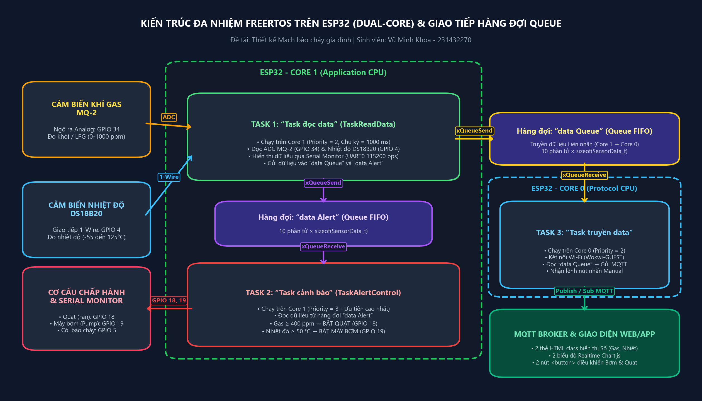
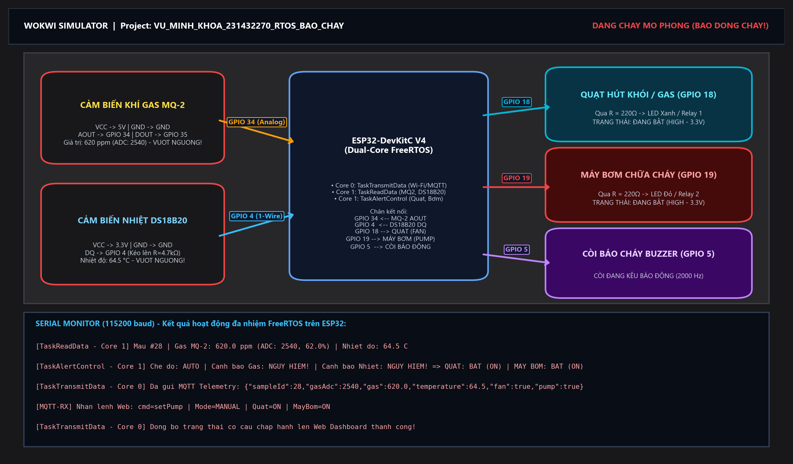
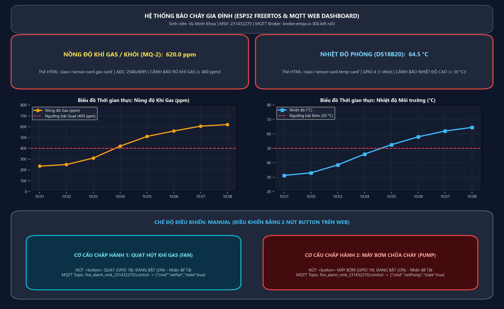

# 🔥 Thiết kế Mạch Báo Cháy Gia Đình sử dụng ESP32, FreeRTOS (Dual-Core) và MQTT

> **Học phần:** Hệ thống Nhúng  
> **Sinh viên thực hiện:** Vũ Minh Khoa  
> **Mã sinh viên:** 231432270  
> **Lớp:** Điện Tử và Tin Học Công Nghiệp 1 - K64  

---

## 📌 Tổng quan Dự án

Hệ thống báo cháy gia đình sử dụng vi điều khiển **ESP32** chạy hệ điều hành thời gian thực **FreeRTOS** trên cả 2 nhân (**Core 0** và **Core 1**):
- Thu thập nồng độ khí gas/khói từ cảm biến **MQ-2 (`GPIO 34`)** và nhiệt độ môi trường từ cảm biến **DS18B20 (`GPIO 4`)**.
- Giao tiếp liên tác vụ an toàn thông qua 2 hàng đợi FreeRTOS: **`data Queue`** và **`data Alert`**, kết hợp với **Mutex / Binary Semaphore**.
- Tự động điều khiển **Quạt hút khí gas (`GPIO 18`)** khi nồng độ khí gas vượt ngưỡng (`≥ 400 ppm`) và **Máy bơm chữa cháy (`GPIO 19`)** khi nhiệt độ vượt ngưỡng (`≥ 50 °C`).
- Truyền dữ liệu thời gian thực lên **MQTT Broker (`broker.emqx.io`)** và hiển thị trực quan trên **Giao diện Web/App (`web_dashboard/index.html`)** gồm:
  - **2 thẻ HTML (`class="sensor-card"` / `class="gas-value"` / `class="temp-value"`)** hiển thị số liệu Nồng độ khí gas và Nhiệt độ.
  - **2 biểu đồ thời gian thực (Chart.js)** cập nhật trực tiếp Nồng độ khí gas và Nhiệt độ.
  - **2 nút `<button>`** điều khiển bật/tắt **Máy bơm** và **Quạt** ở chế độ **Manual**.



---

## 📂 Cấu trúc Thư mục

```text
Lab_RTOS_BaoChay/
├── wokwi_esp32_rtos_baochay/
│   ├── sketch.ino          # Firmware ESP32 FreeRTOS (3 Tasks trên Core 0 & Core 1, 2 Queues)
│   ├── diagram.json        # Sơ đồ mạch nối dây trên Wokwi Simulator
│   ├── libraries.txt       # Các thư viện sử dụng trên Wokwi
│   └── wokwi.toml          # Cấu hình Wokwi cho VS Code
├── web_dashboard/
│   ├── index.html          # Giao diện Web hiển thị 2 thẻ số (class), 2 biểu đồ, 2 nút button
│   └── mqtt_simulator.py   # Script Python giả lập ESP32 gửi/nhận MQTT để kiểm thử nhanh
├── images/                 # Bộ hình ảnh sơ đồ kiến trúc, mạch Wokwi và kết quả Web Dashboard
├── BAO_CAO_LAB_RTOS_BAO_CHAY.md
├── VuMinhKhoa_231432270_Lab_RTOS_BaoChay.docx
└── README.md
```

---

## 🚀 Hướng dẫn Chạy và Kiểm thử

### 1. Chạy mạch mô phỏng trên Wokwi
1. Truy cập [https://wokwi.com/projects/new/esp32](https://wokwi.com/projects/new/esp32).
2. Copy nội dung file `wokwi_esp32_rtos_baochay/sketch.ino` vào tab `sketch.ino`.
3. Copy nội dung file `wokwi_esp32_rtos_baochay/diagram.json` vào tab `diagram.json`.
4. Copy nội dung file `wokwi_esp32_rtos_baochay/libraries.txt` vào tab `libraries.txt`.
5. Nhấn **Start Simulation** và thay đổi thanh trượt nồng độ khí Gas trên cảm biến **MQ-2** hoặc nhiệt độ trên **DS18B20** để quan sát hoạt động của 3 Task trên **Serial Monitor** và 2 đèn LED cơ cấu chấp hành (**Quạt - GPIO 18**, **Máy bơm - GPIO 19**).

### 2. Mở Giao diện Web/App
1. Mở trực tiếp file `web_dashboard/index.html` trên trình duyệt (Chrome / Edge / Firefox).
2. Trang Web tự động kết nối tới MQTT Broker `wss://broker.emqx.io:8084/mqtt` để nhận dữ liệu từ ESP32 Wokwi (hoặc từ script `python web_dashboard/mqtt_simulator.py`).
3. Có thể nhấn các nút kịch bản kiểm thử nhanh ngay trên giao diện Web hoặc nhấn **2 nút `<button>` Quạt & Máy bơm** để điều khiển ở chế độ **Manual**.

---

## 📸 Hình ảnh Kết quả

| Sơ đồ mạch Wokwi khi Báo cháy | Giao diện Web Dashboard (Cảnh báo & Điều khiển Manual) |
| :---: | :---: |
|  |  |
